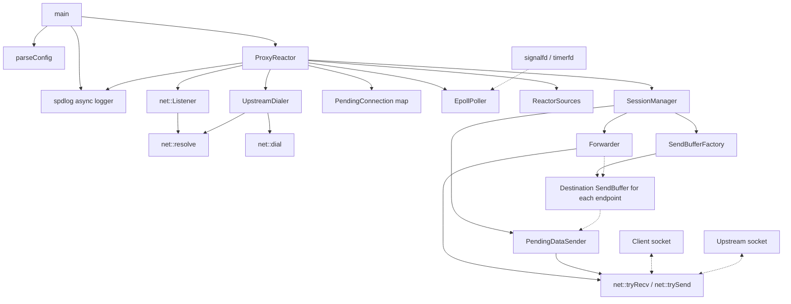
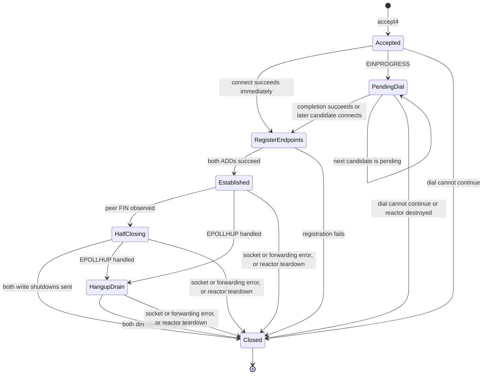

# Orbit architecture

This document describes the current reactor. See [configuration](config.md) for the operator interface, [invariants](invariants.md) for correctness requirements, and [known limitations](known-limitations.md) for findings and follow-up work.

## Purpose and scope

Orbit is a Linux Layer 4 TCP reverse proxy. Each accepted client gets a separate upstream TCP connection. Orbit transfers ordered byte streams in both directions without parsing application messages or relying on their boundaries. The implementation supports concurrent sessions, nonblocking upstream connection establishment, forwarding with directional buffering and backpressure, TCP half-close propagation, and signal-driven shutdown.

The configuration accepts multiple upstream endpoints. The runtime resolves only the first endpoint and can try its resolved addresses in order. Health-aware routing among configured endpoints, bounded dial lifetimes, and explicit admission and memory budgets are future work toward a resource-efficient, fault-tolerant Layer 4 load balancer.

## Startup and runtime

1. [`main`](../src/main.cpp) builds and blocks the `SIGINT` and `SIGTERM` mask before configuration and logger startup. It calls `parseConfig`, starts the async logger, and passes the listen address and `config.upstreams.front()` to `ProxyReactor::create`.
2. [`ProxyReactor::create`](../src/proxy/proxy.cpp) creates the epoll instance, nonblocking `signalfd` and `timerfd`, and `UpstreamDialer`. The dialer resolves and stores the selected upstream. `Listener::create` then resolves the listen host and tries addresses in order until it can create a nonblocking close-on-exec socket, set `SO_REUSEADDR`, bind, listen with a requested backlog of 64, and obtain the local address. There is one successful listener. The reactor registers it and the two shutdown descriptors.
3. `ProxyReactor::start` waits for ready sources and dispatches their registered roles. The listener accepts clients and initiates upstream dials. A successful dial allows the reactor to register both endpoints and install the session in `SessionManager`. A pending dial owns the two sockets in the reactor's pending map.
4. Endpoint handlers forward data and report session-local outcomes. The reactor updates readiness interests or removes the session. During shutdown it closes the listener, processes established sessions until its stop condition, and releases remaining resources as described below.

Solid arrows show calls or dispatch. Dashed arrows show TCP byte flow or shutdown notifications. The logger receives messages from the reactor and writes to stdout on its own worker.

## Component boundaries

| Component and source | Interface, state, and lifetime |
| --- | --- |
| [`main`](../src/main.cpp), [`Config` and `parseConfig`](../src/config/config.cpp) | CLI11 reads options and environment inputs into an ordered configuration value. `main` owns the parsed config and logger guard. The reactor receives endpoint values during creation and holds the resolved addresses it needs at runtime. |
| [`ProxyReactor`](../src/proxy/proxy.h) | `create` acquires and registers startup resources. `start` runs the event loop. The reactor owns the listener, poller, source registry, session manager, dialer, pending map and shutdown descriptors. It coordinates fd registration and maintains the shutdown state. |
| [`EpollPoller`](../src/proxy/detail/epoll/epoll_poller.h) and [`ReactorSources`](../src/proxy/detail/sources/reactor_sources.h) | The poller owns the epoll fd, event array and watched records containing borrowed fd numbers and cached masks. The registry owns the ID generator and dispatch metadata. `wait` returns event values, and `find` returns a registration by value. |
| [`net::Listener`](../src/net/listener.h) | Owns the listening fd and bound address. `acceptClientConnection` returns an owning client fd and the remote address, a would-block result, or an error. The reactor stores it in an optional `ActiveListener` until retirement or destruction. |
| [`UpstreamDialer`](../src/proxy/detail/upstream_dialer.h), [`ResolvedUpstream`](../src/proxy/detail/resolved_upstream.h), and [`PendingConnection`](../src/proxy/detail/pending_connection.h) | The dialer stores the configured endpoint and resolved candidate vector for the reactor lifetime. `dial` and `advanceDialAttempt` move client ownership through pending or connected results. Per-dial candidate index, errors and fds live in the pending value and, between readiness events, in the reactor's pending map. |
| [`SessionManager`](../src/proxy/detail/session/session_manager.h) and [`Session`](../src/proxy/detail/session/session_state.h) | The manager owns the established-session map, ID generator, buffer factory and I/O helpers. `add` takes ownership of both fds after registration. Endpoint handlers mutate that session's flags and queues and return keep/close outcomes. `interests` and `shouldRetire` report desired polling state to the reactor. A session lives until map removal or manager destruction. |
| [`Forwarder`](../src/proxy/detail/forwarding.cpp) and [`PendingDataSender`](../src/proxy/detail/pending_data_sender.cpp) | `forward` handles ordinary and residual input, and `sendPending` handles queued output on a writable destination. Each helper owns one scratch array for the manager lifetime and borrows session endpoints during calls. Both use [`net::tryRecv` and `net::trySend`](../src/net/socket_io.cpp) as applicable. |
| [`SendBufferFactory`](../src/proxy/detail/buffer/send_buffer_factory.cpp) and [`SendBuffer`](../src/proxy/detail/buffer/send_buffer.h) | The factory holds three size parameters from the reactor. Each endpoint owns a queue through a `unique_ptr`. The noncopyable, nonmovable queue owns its blocks and tracks FIFO offsets, logical byte count and admission state. `write`, `copy`, and `consume` are its data-plane interface. |
| [`FileDescriptor`](../src/common/fd.h), [`Result` and `Status`](../src/common/status.h), and [`LoggerGuard`](../src/logging/logger.cpp) | The movable fd wrapper calls `close` on its current valid fd and clears the moved-from value. Syscall and domain failures propagate through `std::expected` where handled explicitly. The logger guard shuts down the spdlog worker and can report queue overruns on exit. |

## Execution model

One application thread, the main thread, owns and mutates the reactor, poller metadata, dial state and all sessions. Dispatch runs synchronously from the readiness loop and no two handlers execute concurrently. Socket concurrency comes from multiplexing many connections through one epoll instance. No locks or atomics protect the data-plane structures. The process also runs one spdlog worker, with an 8,192-entry async log queue that overwrites the oldest entry on overflow.

The two `getaddrinfo` calls during startup are synchronous and may block in name resolution. Socket setup and I/O syscalls, numeric address formatting, allocations, and log submission execute on the reactor thread when called there. The data-plane sockets are nonblocking. A pending `connect` progresses in the kernel and is revisited on readiness. The intentional steady-state wait is `epoll_wait` with an indefinite timeout. There is no periodic polling or off-thread resolver. Nonblocking syscalls still leave synchronous work in a handler, including candidate scans. See [LIM-009](known-limitations.md#lim-009--reactor-work-budgets-are-incomplete).

## Upstream selection and dialing

[`parseConfig`](../src/config/config.cpp) stores every syntactically valid endpoint as `UpstreamConfig { host, port }`. It requires one or more entries, supports bracketed host syntax for IPv6 and checks the decimal port range. See [configuration](config.md) for options and startup validation.

[`ResolvedUpstream::create`](../src/proxy/detail/resolved_upstream.cpp) calls [`net::resolve`](../src/net/resolver.cpp) once for the first configured entry. The resolver uses `AF_UNSPEC`, `SOCK_STREAM`, `AI_ADDRCONFIG` and `AI_NUMERICSERV`. The listener uses the same helper with `AI_PASSIVE`. Candidates may be IPv4 or IPv6 as permitted by the host and resolver. `SocketAddress` stores each address and its length, and sockets are created with the candidate's family. Address formatting uses numeric host and service flags and brackets IPv6. There is no re-resolution after startup.

For each accepted client, [`UpstreamDialer::tryCandidatesFrom`](../src/proxy/detail/upstream_dialer.cpp) starts with candidate zero. [`net::dial`](../src/net/dialer.cpp) creates a fresh nonblocking close-on-exec socket. `connect` returning zero yields an immediate success. `EINPROGRESS` yields a pending attempt. `EINTR` restarts the attempt for that candidate with a fresh socket after RAII closes the previous one. Other immediate connect errors advance to the next candidate. Socket creation errors stop the candidate scan.

While pending, the reactor watches only the attempted upstream socket for `EPOLLOUT` and implicit error or hangup events. The accepted client is kept open. Orbit has no client-side polling or application buffering at this stage. `handlePendingConnection` moves the pending record out, erases it and removes the old registration before calling `advanceDialAttempt`. That function checks `SO_ERROR` via `getsockopt`. Zero yields a connected result. A nonzero value or syscall error records the failure, closes the failed socket and continues from the next address. Each new pending attempt receives fresh pending and source IDs. Exhausting the candidates returns the collected errors and drops the client. There is no fallback across configured upstream entries, backoff, or application-level per-attempt or overall dial deadline. A connected session remains pinned to its socket pair.

## Connection and session lifecycle

The diagram is conceptual. `PendingConnection` and the established-session map are separate representations. The established phase uses endpoint flags, and either direction can reach the half-close condition first.

- **Accepted.** `handleListener` processes at most 16 accept results per invocation. `accept4` sets `SOCK_NONBLOCK | SOCK_CLOEXEC`. The client fd moves into the dialer and then into either pending or connected state. No `Session` exists until an upstream connects and both endpoint registrations succeed.
- **Established.** `addSession` allocates a session ID and adds downstream and upstream source registrations, each carrying the session ID and role. If the second add fails it attempts to roll back the first. On success it moves both fds into the manager, which creates two empty send buffers and initializes all endpoint flags to false.
- **Half-closing.** `EPOLLRDHUP` sets `peer_half_closed` on the source. A zero-byte receive sets `done_reading`. When both flags are set and the destination's buffer is empty, `halfCloseIfReady` calls `shutdown(destination, SHUT_WR)` and sets that destination's `half_close_sent` on success. Read, write and peer-half-close handlers check this condition. The opposite stream can continue, whether the client or upstream sent the first FIN. Ordinary session teardown follows two successful write shutdowns. A shutdown syscall error is logged and keeps the session open, with no dedicated retry mechanism.
- **Full hangup.** The endpoint releases its output queue and retains its fd for residual input. One admitted receive appends at most one chunk behind the surviving destination’s queued bytes. Each positive residual receive leaves output pending, so level-triggered writable progress on that destination continues the drain. A paused queue resumes at the low watermark. The hung-up source uses edge triggering until EOF, allowing a fresh input edge after would-block without repeatedly reporting a persistent HUP. Once EOF is consumed its watch can retire while the destination finishes flushing.
- **Abrupt termination and cleanup.** `EPOLLERR` and unrecoverable forwarding or pending-send errors lead to session closure during established I/O. `closeSession` attempts to retire both remaining registrations, removes dispatch metadata and erases the session. Erasure closes both fds and destroys the queues. If the reactor exits with entries still in its maps, object destruction releases them.

## Forwarding and backpressure

The same path handles both directions. For client-to-upstream traffic the upstream endpoint is the destination and owns that direction's queue. For upstream-to-client traffic the downstream endpoint is the destination and owns its queue.

1. `SessionManager::handleReadable` calls `Forwarder::forward` with the readable endpoint as source. `net::tryRecv` reads up to 4,096 bytes into the shared forwarder scratch array. On EOF it marks the source done reading. On would-block it leaves the source open.
2. For ordinary input, if the destination queue is empty, `forward` tries to send the newly read bytes immediately. If the send is partial, `storeUnsent` appends only the suffix. Would-block reports zero bytes sent so the whole chunk is queued. If the queue already contains earlier bytes, `bufferData` appends the entire chunk behind them. A hard immediate send failure queues the chunk before returning an error, and the caller then closes the session.
3. `SessionManager::handleWritable` calls `PendingDataSender::sendPending` with that endpoint as destination. `SendBuffer::copy` copies up to 4,096 bytes from the FIFO front into the sender's scratch array without consuming them. One send attempt follows. `SendBuffer::consume` removes only the reported sent bytes, including zero for would-block. The next writable notification continues from that position.
4. `tryRecv` and `trySend` retry `EINTR` and distinguish `EAGAIN` or `EWOULDBLOCK` from hard errors. Sends use `MSG_NOSIGNAL`. A successful send transfers bytes to the kernel's TCP queue. Connection errors and forced closure can prevent delivery to the peer.

`SendBuffer` uses a singly linked chain of lazily allocated blocks, with a read offset, a write offset and a logical byte count. Live defaults in [`ProxyReactor`](../src/proxy/proxy.h) are 4 KiB blocks, a high watermark of 256 KiB and a low watermark of 192 KiB. `SendBuffer::updateStatus` pauses an accepting queue at or above high and resumes a paused queue at or below low. The manager requests `EPOLLIN` on a source only when it is still reading, its destination is live for writes, and the destination's queue is accepting. After each kept event action the reactor synchronizes interest on both endpoints, including read resumption after a writable event consumes data. Level-triggered readiness can report remaining bytes or EOF on resumption.

Every receive checks the destination’s write state and admission. An enqueue can cross the high watermark by up to 4,095 bytes because the whole admitted chunk is written before the status update. Residual input uses the same admission and FIFO ordering.

Logical bytes count unsent payload. Allocated buffer memory includes full payload blocks, unused space in live blocks, node metadata and allocator overhead. Consumption frees fully traversed blocks, and an empty buffer can retain one partially used block until reuse, later consumption or destruction. Two 4 KiB scratch arrays are shared across sessions. Process memory also includes maps, event arrays, logger resources, and allocator behavior after deallocation. Kernel TCP send and receive queues are separate from all of these. The reactor enforces no aggregate application buffer budget, no cap on established sessions or pending dials, and no application-level control of TCP queue memory. The requested listener backlog and OS resource limits are independent constraints. The unused `Config::send_buffer` is described in [LIM-007](known-limitations.md#lim-007--sendbufferconfig-is-disconnected-from-runtime).

## Epoll registration and dispatch

[`EpollPoller`](../src/proxy/detail/epoll/epoll_poller.cpp) uses level triggering for ordinary I/O, edge triggering for residual hangup input, and a buffer of up to 1,024 events per wait. It retries an interrupted wait. `add` writes the `SourceId` to `epoll_event.data.u64`. `setInterests` uses `EPOLL_CTL_MOD` if the requested mask differs from the cached mask. `remove` keeps tracking on deregistration failure. `retire` drops poller metadata even if `EPOLL_CTL_DEL` fails. Reactor registration failures undo the new source record. Ordinary close removes dispatch metadata even if retirement errors, and preserves RAII cleanup. Linux reports error and hangup even when the interest mask omits those flags. [`epoll(7)`](https://man7.org/linux/man-pages/man7/epoll.7.html), [`epoll_ctl(2)`](https://man7.org/linux/man-pages/man2/epoll_ctl.2.html).

| Source or flag | Applicable state | Registration and action |
| --- | --- | --- |
| Listener | Running | Requests `EPOLLIN`. Any event for its registered source dispatches `handleListener`, which stops on would-block or after the accept batch. |
| Pending upstream | One in-progress dial | Requests `EPOLLOUT`. Any returned mask, including error/hangup, triggers `handlePendingConnection` and the `SO_ERROR` check. The pending downstream fd has no registration. |
| Established `EPOLLIN` | Either endpoint, while its source read interest is enabled | Both endpoints initially request `EPOLLIN`. `handleReadable` attempts one normal receive and forwarding step. Interest depends on the opposite endpoint's buffer and write state. |
| Established `EPOLLOUT` | Either destination with queued bytes and usable write side | Enabled while output is queued. `handleWritable` attempts one buffered send and may make the opposite endpoint readable again. |
| Established `EPOLLRDHUP` | Either endpoint before the peer half-close is recorded | Enabled initially on both endpoints and removed after the flag is recorded. `handlePeerHalfClosed` checks whether forwarding and EOF permit `SHUT_WR`. |
| Established `EPOLLERR` | Either watched endpoint | `handleError` reads `SO_ERROR` for diagnostics and closes the pair. |
| Established `EPOLLHUP` | Either watched endpoint | Disables output to this endpoint and attempts one admitted residual receive. An edge-triggered watch tolerates persistent HUP while the surviving destination controls progress. |
| Signal or shutdown timer | While registered | Both request `EPOLLIN`. Dispatch drains the associated fd and processes shutdown requests. Neither handler branches on the incoming mask. |

For an established endpoint, error takes priority over full hangup. Either consumes the event. Otherwise the reactor handles readable, writable and peer-half-close flags in sequence, synchronizing both endpoints after each kept action. Retirement or teardown ends that notification.

An event batch may contain both endpoints of one session. Before dispatch the reactor looks up each event's `SourceId` afresh. After teardown or retirement a removed source ID no longer resolves. `handleEndpoint` also checks session membership. Retirement always erases the identity, including on a kernel DEL error. Fresh registrations use new 64-bit IDs, so ordinary reuse of the underlying fd number does not bind an earlier event to a new socket. The ID generator increments without an explicit wrap check. A live registration can also receive a copied mask after its interests change. The I/O handlers check directional admission at use. See [LIM-003](known-limitations.md#lim-003--a-live-event-can-outlast-its-read-interest) and [LIM-008](known-limitations.md#lim-008--source-identities-have-no-wrap-policy).

## Resource ownership

| Resource | Acquisition and owner | Transfer and release |
| --- | --- | --- |
| Epoll fd and event storage | `EpollPoller::create` wraps `epoll_create1`. The poller owns the fd and reusable event array. | The poller moves into the reactor. Returned event vectors are per-wait values. Poller destruction closes epoll and its remaining registrations, including on startup or loop failure. |
| Listener fd | `Listener::create` wraps each socket attempt and retains the first fully initialized listener. | Failed candidates close on scope exit. The successful listener moves into `active_listener_`. Graceful shutdown deregisters and resets it. Reactor destruction closes it on other exit paths. |
| Accepted client fd | `acceptClientConnection` wraps `accept4` in `AcceptSuccess`. | Moves into the dialer and its `PendingConnection` or connected result, then into the downstream session endpoint after registration. Dial exhaustion, failed registration or object destruction closes the current owner's fd. |
| Attempted and connected upstream fd | `net::dial` wraps `socket` before `connect`. | A pending attempt owns its fd in an optional and closes it on failed completion before dialing the next address. Immediate or asynchronous success moves it through `UpstreamDialConnected` into the upstream session endpoint. A failed handoff releases the local owner. Pending records still in the map close both fds at reactor destruction. |
| Session and directional queues | `SessionManager::add` inserts a session by value. Each endpoint owns its fd and a unique `SendBuffer`. Its blocks are allocated on demand. | Session removal closes both fds and destroys both queues, even when an endpoint was retired earlier. Remaining sessions are destroyed with their manager. Queue destruction releases all remaining blocks iteratively. |
| Forwarding and sending scratch arrays | `Forwarder` and `PendingDataSender` each allocate their own 4 KiB array when the manager is created. | The arrays live with those helpers and are reused serially across sessions. Spans passed to socket and buffer helpers borrow array memory for the call. |
| Signal and timer resources | `main` blocks the shutdown signals. `createShutdownSignalFd` and `createShutdownTimerFd` return owning wrappers. | The fds move to the reactor and close at destruction. The startup thread mask stays in effect for the process lifetime, and the logging worker inherits it. No asynchronous signal handler owns proxy state. |
| DNS results, logger and kernel queues | `net::resolve` temporarily owns the `addrinfo` list with a `freeaddrinfo` deleter. The dialer owns copied candidates. `setUpLogger` creates the worker, queue and sink. The kernel owns TCP state and queues. | Resolver results are freed after copying. `LoggerGuard` outlives the reactor and invokes spdlog shutdown. Closing Orbit's last fd releases its reference to a socket. The kernel can retain TCP protocol state after close. |

`FileDescriptor::get` yields a borrowed integer. Moves invalidate the source wrapper, move assignment closes the previous destination fd, and destruction closes a still-owned fd. Source IDs, session IDs and pending IDs are values for lookup. Session references, spans and the buffer's tail pointer borrow storage owned elsewhere and stay within the appropriate owner lifetime.

## Failure handling

| Failure or condition | Current result |
| --- | --- |
| Invalid options or upstream syntax | Invalid CLI values and upstream syntax produce a diagnostic and `main` returns the CLI11 exit code. Environment values that fail listen-port or log-level validators are ignored, leaving defaults. Help and version also return through this interface. See [configuration](config.md). |
| Selected upstream resolution fails or yields no addresses | Reactor creation fails, `main` logs the startup error and exits unsuccessfully. Later configured endpoints are not considered. Listener resolution or exhausting listener setup candidates also fails startup. |
| Client or upstream reset after establishment | A receive/send error or `EPOLLERR` closes that session and logs the failure. `EPOLLERR` attempts to retrieve the socket error. |
| Refused upstream connection | The dialer advances to the next resolved address. If the terminal error list contains only errors classified nonfatal, Orbit logs the failure and drops the client. Refusal alone is nonfatal. |
| Pending upstream connection | Both sockets remain owned and only the upstream attempt is watched. A completion event may establish, advance or end the dial. Without an event there is no application-level expiry. |
| Hard receive or send error | Forwarding and pending-send handlers report a session-local close. `EINTR` retries, would-block preserves progress, and a failed `SHUT_WR` is logged with a keep-open outcome. |
| Socket creation fails | Listener setup tries later resolved addresses. Dial setup stops at the failed socket creation and reports accumulated errors. The reactor decides process fatality from the final errno list. |
| Terminal dial error | `isFatalDialError` treats `EADDRINUSE`, `EAGAIN`, `EALREADY`, `ECONNREFUSED`, `EISCONN`, `ENETUNREACH`, `EHOSTUNREACH` and `ETIMEDOUT` as nonfatal. Any other errno in the final error list ends the reactor. Success on a later candidate bypasses that terminal check. |
| Epoll registration or update fails | Startup ADD failure ends initialization. Pending-dial ADD or pending DEL failure, established MOD failure, hangup retirement failure during synchronization, or a failed endpoint rollback ends the reactor. Endpoint ADD failure after successful rollback or before the pair has any registrations drops the pair and logs it. A DEL failure during session close is logged while metadata and fd ownership are still released. A wait failure ends the reactor. |
| Slow consumer or saturation | Both ordinary and residual forwarding pause source reads and resume at the low watermark. There is no slow-consumer deadline. |
| fd exhaustion at accept or upstream socket creation | `EMFILE` and `ENFILE` are fatal in these paths. There is no reserve fd or overload backoff. The listener warns and continues its bounded batch only for the errors in `isRecoverableAcceptError`. |
| Heap allocation failure | Queue, map and event allocations have no dedicated recovery policy. The explicit syscall error paths do not cover allocation exceptions. |

The reactor logs connection and session setup, pending registration at debug level, and failures through spdlog. A fatal reactor error propagates through `start` to an unsuccessful exit from `main`. No failure path feeds a health monitor or a load-balancing policy.

## Shutdown

1. [`main`](../src/main.cpp) blocks `SIGINT` and `SIGTERM` before starting the logger. [`drainSignalFd`](../src/proxy/detail/signal_fd.cpp) converts readable signal records into shutdown requests in the reactor thread. Standard signals can coalesce, so escalation is based on observed records.
2. The first handled request arms a one-shot [`CLOCK_MONOTONIC` timerfd](../src/proxy/detail/timer_fd.cpp) for 30 seconds, unregisters and closes the listener, and moves `Running` to `GracefullyStopping`. A listener event already processed before this request may have admitted clients. Later entries for the removed listener ID are ignored.
3. Established sessions continue normal forwarding and teardown. The reactor exits gracefully as soon as the established-session map is empty, checked at the loop boundary and after dispatch. Pending dials do not count toward that condition. While an established session keeps the loop running, a pending dial can complete and become established or advance to another address during graceful shutdown. A pending-only reactor can exit before processing a ready dial. Remaining pending entries close their sockets when the reactor is destroyed.
4. The timer event or another observed shutdown request disarms the timer, enters `HardStopping` and removes all established sessions using `forceCloseAllSessions`. There is no guarantee of a final flush on forced close. The deadline starts when the first request is processed and escalation requires the loop to dispatch the ready timer. A signal/timer read error, timer programming error or listener removal error ends the loop through the fatal path. On all ordinary return paths RAII releases the remaining reactor resources before logger shutdown.

## Build and testing

- [Root CMake configuration](../CMakeLists.txt) requires CMake 3.28 or newer and a compiler and standard library with C++23 features such as `std::expected` and `std::format`. It disables compiler extensions and exports compile commands. The Ninja [build presets](../CMakePresets.json) use GCC 15 for Debug and Release and Clang 22 with libstdc++ for ASan and UBSan.
- The executable is `orbit`. Library targets are `proxy`, `config`, `logging`, `net`, `signal` and interface target `common`, defined by the module CMake files under [`src/`](../src/). CMake fetches pinned spdlog v1.17.0, CLI11 v2.6.2 and Abseil 20260107.1. All three presets enable `ORBIT_BUILD_TESTS`, which fetches GoogleTest v1.17.0 and requires a Python 3.10 or newer interpreter.
- [`tests/CMakeLists.txt`](../tests/CMakeLists.txt) registers the GoogleTest executables `config_tests`, `net_tests` and `proxy_tests` for discovery at CTest time. Each discovered test is labeled `unit` with a 15-second timeout. The tests cover upstream parsing and order, address formatting, and FIFO buffer behavior including watermark overshoot, hysteresis and argument validation.
- [`integration_proxy_sessions`](../tests/integration/CMakeLists.txt) is a serial CTest entry labeled `integration` with a 45-second timeout. The [Python harness](../tests/integration/proxy_sessions_test.py) starts the selected build's Orbit executable for session tests and owns the loopback sockets and child cleanup. Scenarios cover upstream reset isolation, session churn, both half-close directions, large transfers with delayed reads, unsaturated full hangups, idle CPU after hangup, graceful drain and second-signal escalation. Harness tests exercise early exit, shutdown failures with large output and forced cleanup. See [LIM-011](known-limitations.md#lim-011--fault-and-readiness-tests-leave-gaps) for fault coverage gaps.
- [GitHub Actions CI](../.github/workflows/ci.yaml) validates both test categories across all three presets on Ubuntu 26.04 for pushes and pull requests targeting `main`. See the [development guide](development.md) for commands, timeout behavior and failure diagnostics.
