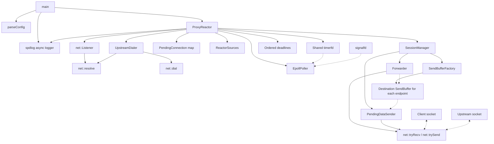

# Orbit architecture

This document describes the current reactor. See [configuration](config.md) for the operator interface, [invariants](invariants.md) for correctness requirements, and [known limitations](known-limitations.md) for findings and follow-up work.

## Purpose and scope

Orbit is a Linux Layer 4 TCP reverse proxy. Each accepted client gets a separate upstream TCP connection. Orbit transfers ordered byte streams in both directions without parsing application messages or relying on their boundaries. The implementation supports concurrent sessions, nonblocking upstream connection establishment, forwarding with directional buffering and backpressure, TCP half-close propagation, and signal-driven shutdown.

The configuration accepts multiple upstream endpoints. The runtime resolves only the first endpoint and can try its resolved addresses in order. Orbit limits total and pending admission, bounds each forwarding direction, and enforces a shared forwarding payload budget. Health-aware routing remains future work.

## Startup and runtime

1. [`main`](../src/main.cpp) builds and blocks the `SIGINT` and `SIGTERM` mask before configuration and logger startup. It calls `parseConfig`, starts the async logger, and passes the listen address, `config.upstreams.front()`, timeouts and resource settings to `ProxyReactor::create`.
2. [`ProxyReactor::create`](../src/proxy/proxy.cpp) creates the epoll instance, nonblocking `signalfd` and `timerfd`, and `UpstreamDialer`. The dialer resolves and stores the selected upstream. `Listener::create` then resolves the listen host and tries addresses in order until it can create a nonblocking close-on-exec socket, set `SO_REUSEADDR`, bind, listen with a requested backlog of 64, and obtain the local address. There is one successful listener. The reactor registers the listener, signal fd and timerfd.
3. `ProxyReactor::start` waits for ready sources and dispatches their registered roles. The listener accepts and dials upstream when both admission limits have room. A successful dial allows the reactor to register both endpoints and move the existing admission into `SessionManager`. A pending dial owns the two sockets in the reactor's pending map.
4. Endpoint handlers forward data and track qualifying socket I/O when idle expiration is enabled. The reactor applies deadline and readiness changes or removes the session. During shutdown it closes the listener, processes established sessions until its stop condition, and releases remaining resources as described below.

Solid arrows show calls or dispatch. Dashed arrows show TCP byte flow and kernel notifications. The logger receives messages from the reactor and writes to stdout on its own worker.

## Component boundaries

| Component and source | Interface, state, and lifetime |
| --- | --- |
| [`main`](../src/main.cpp), [`Config` and `parseConfig`](../src/config/config.cpp) | CLI11 reads options and environment inputs into an ordered configuration value. `main` owns the parsed config and logger guard. The reactor receives endpoint values during creation and holds the resolved addresses it needs at runtime. |
| [`ProxyReactor`](../src/proxy/proxy.h) | `create` acquires and registers startup resources. `start` runs the event loop. The reactor owns the listener, poller, source registry, session manager, dialer, pending map and the signal and shared deadline descriptors. It coordinates fd registration and maintains the shutdown state. |
| [`EpollPoller`](../src/proxy/detail/epoll/epoll_poller.h) and [`ReactorSources`](../src/proxy/detail/sources/reactor_sources.h) | The poller owns the epoll fd, event array and watched records containing borrowed fd numbers and cached masks. The registry owns the ID generator and dispatch metadata. `wait` returns event values, and `find` returns a registration by value. |
| [`net::Listener`](../src/net/listener.h) | Owns the listening fd and bound address. `acceptClientConnection` returns an owning client fd and the remote address, a would-block result, or an error. The reactor stores it in an optional `ActiveListener` until retirement or destruction. |
| [`UpstreamDialer`](../src/proxy/detail/upstream_dialer.h), [`ResolvedUpstream`](../src/proxy/detail/resolved_upstream.h), and [`PendingConnection`](../src/proxy/detail/pending_connection.h) | The dialer stores the resolved candidate vector. The reactor's pending map owns each admitted dial's candidate index, original deadline and descriptors when work awaits readiness, a timer or a later turn. |
| [`SessionManager`](../src/proxy/detail/session/session_manager.h) and [`Session`](../src/proxy/detail/session/session_state.h) | The manager owns the established-session map, ID generator, buffer factory and I/O helpers. `add` takes ownership of both fds after registration. Endpoint handlers mutate that session's flags and queues and return keep/close outcomes. `interests` and `shouldRetire` report desired polling state to the reactor. A session lives until map removal or manager destruction. |
| [`Forwarder`](../src/proxy/detail/forwarding.cpp) and [`PendingDataSender`](../src/proxy/detail/pending_data_sender.cpp) | `forward` handles ordinary and residual input, and `sendPending` handles queued output on a writable destination. Each helper owns one scratch array for the manager lifetime and borrows session endpoints during calls. Both use [`net::tryRecv` and `net::trySend`](../src/net/socket_io.cpp) as applicable. |
| [`SendBufferFactory`](../src/proxy/detail/buffer/send_buffer_factory.cpp) and [`SendBuffer`](../src/proxy/detail/buffer/send_buffer.h) | The factory holds three size parameters from the reactor. Each writable endpoint owns a queue through a `unique_ptr`. The noncopyable, nonmovable queue owns its blocks and tracks FIFO offsets, logical byte count and admission state. `write`, `copy`, and `consume` are its data-plane interface. |
| [`FileDescriptor`](../src/common/fd.h), [`Result` and `Status`](../src/common/status.h), and [`LoggerGuard`](../src/logging/logger.cpp) | The movable fd wrapper calls `close` on its current valid fd and clears the moved-from value. Syscall and domain failures propagate through `std::expected` where handled explicitly. The logger guard shuts down the spdlog worker and can report queue overruns on exit. |

The dialer stores optional callbacks for `socket` and `connect`. The session manager stores a separate pair for `recv` and `send` and passes them to the forwarding helpers. Each record holds function pointers and a borrowed context for the lifetime of its component. The production defaults call Linux directly after a null check. The helpers still implement syscall error handling and acquire or borrow descriptors through the existing RAII owners.

## Execution model

One application thread, the main thread, owns and mutates the reactor, poller metadata, dial state and all sessions. Dispatch runs synchronously from the readiness loop and no two handlers execute concurrently. Socket concurrency comes from multiplexing many connections through one epoll instance. No locks or atomics protect the data-plane structures. The process also runs one spdlog worker, with an 8,192-entry async log queue that overwrites the oldest entry on overflow.

The two `getaddrinfo` calls during startup are synchronous and may block in name resolution. Socket setup and I/O syscalls, allocations and log submission execute on the reactor thread. The data-plane sockets are nonblocking. A pending `connect` progresses in the kernel and is revisited on readiness.

### Work per reactor turn

| Source | Work limit |
| --- | --- |
| Epoll | One poll collects up to 1,024 events in fixed arrays. Orbit dispatches the complete batch in order except when the reactor stops. An interrupted poll yields an empty batch. |
| Listener | At most 16 single `accept4` calls per listener notification. The handler also yields when the shared batch dial budget is spent. |
| Dialing from readiness | At most eight new socket and connect attempts across listener and pending completion events in one batch. Each pending event can check `SO_ERROR` once. |
| Deferred dialing | Up to eight FIFO entries after the batch. Each gets at most one new socket and connect attempt. A dial that needs more candidates joins the back of the FIFO. |
| Established I/O | Each readable or writable handler processes one 4 KiB chunk at most, plus one bounded residual read after a writable event when needed. A full-hangup event supersedes other flags and processes at most one residual read. |
| Timer and signals | One read per notification. The timer processes up to 64 due keys and gives a due graceful shutdown priority. A signal read consumes at most two shutdown requests. |
| Global read resumption | One FIFO waiter after each readiness batch when a block is available. |

The poll uses zero timeout when a deferred dial or global waiter can run. Otherwise epoll blocks until I/O, the shared timer or a signal is ready. Interrupted accept and ordinary I/O yield to level-triggered readiness. Interrupted residual reads and FIN propagation have one-shot 1 ms timer continuations. A dial that spends its slice on an interrupted call, or whose completion query is interrupted, waits for the same 1 ms retry interval. Resource cooldown pauses new socket attempts for 100 ms. A pending connection's original deadline can end it during any wait.

Each turn creates opportunities for ready sessions, deadlines and shutdown even during sustained acceptance, address failures or global buffer releases. These are work-count bounds on the targeted paths. Hash table maintenance can still visit entries proportional to configured admission and depends on the allocator. Teardown can visit all admitted connections and free all owned buffer blocks. See [LIM-009](known-limitations.md#lim-009--reactor-work-budgets-are-incomplete) for the remaining latency limits.

## Upstream selection and dialing

[`parseConfig`](../src/config/config.cpp) stores every syntactically valid endpoint as `UpstreamConfig { host, port }`. It requires one or more entries, supports bracketed host syntax for IPv6 and checks the decimal port range. See [configuration](config.md) for options and startup validation.

[`ResolvedUpstream::create`](../src/proxy/detail/resolved_upstream.cpp) calls [`net::resolve`](../src/net/resolver.cpp) once for the first configured entry. The resolver uses `AF_UNSPEC`, `SOCK_STREAM`, `AI_ADDRCONFIG` and `AI_NUMERICSERV`. The listener uses the same helper with `AI_PASSIVE`. Candidates may be IPv4 or IPv6 as permitted by the host and resolver. `SocketAddress` stores each address and its length, and sockets are created with the candidate's family. Address formatting uses numeric host and service flags and brackets IPv6. There is no re-resolution after startup.

For each accepted client, [`UpstreamDialer::tryCandidatesFrom`](../src/proxy/detail/upstream_dialer.cpp) starts with candidate zero. [`net::dial`](../src/net/dialer.cpp) creates a fresh nonblocking close-on-exec socket. `connect` returning zero yields an immediate success. `EINPROGRESS` yields a pending attempt. `EINTR` preserves the current candidate for another attempt with a fresh socket. Candidate-local errors advance to the next address. Resource pressure or an infrastructure error stops the scan. Exhausting the work slice defers the client with its candidate position and both admission slots.

While waiting for the kernel, the reactor watches only the attempted upstream socket for `EPOLLOUT` and implicit error or hangup events. It keeps the accepted client open without polling or forwarding from it. `takePending` extracts the owning record and retires the watch before `advanceDialAttempt` checks `SO_ERROR`. Zero yields a connected result. A candidate-local failure closes the failed socket before the next attempt. If a budget or cooldown prevents that attempt now, the record joins the deferred FIFO. An interrupted completion query retains the attempted fd for a timed retry. Each new watch uses a fresh source ID. Exhausting the candidates drops the client and reports the last failure's operation and error code.

The connect budget starts before candidate zero. Each candidate and interrupted retry checks the original deadline before socket preparation. The networking helper checks the same absolute time after acquiring the socket and immediately before `connect()`. If it observes expiry, RAII releases the prepared socket and the dialer ends the sequence locally. The check and syscall are separate operations subject to ordinary scheduling. Completion checks the deadline before reading `SO_ERROR`, and the reactor checks it again at the session ownership handoff. A pending client is retained until completion, cancellation, or expiry. A connected session remains pinned to its socket pair.

## Connection and session lifecycle

The diagram is conceptual. `PendingConnection` and the established-session map are separate representations. The established phase uses endpoint flags, and either direction can reach the half-close condition first.

- **Accepted.** `handleListener` processes at most 16 accept results per invocation. Before calling `accept4`, it reserves both a total and an establishment slot. `accept4` sets `SOCK_NONBLOCK | SOCK_CLOEXEC`. The client fd moves into the dialer and then into either pending or connected state. No `Session` exists until an upstream connects and both endpoint registrations succeed.
- **Established.** `addSession` prepares both socket owners and empty buffers before adding either endpoint watch. It then installs the optional idle deadline and checks the original dial deadline before transferring the session to the manager. On a handled failure it cancels any new deadline and retires any installed watch before the socket owners close.
- **Half-closing.** A zero-byte receive completes the input stream. Once the destination queue is empty, Orbit calls `shutdown(SHUT_WR)` and records success once. An interruption defers the FIN to the shared timer. A terminal failure closes the pair locally. `EPOLLRDHUP` records a peer FIN observation and suppresses repeated notifications. Either peer can continue sending until its own input EOF. The session ends when both destinations have successfully shut down writes or fully hung up.
- **Full hangup.** The endpoint releases its output queue and retains its fd for residual input. One admitted receive appends at most one chunk behind the surviving destination’s queued bytes. Each positive residual receive leaves output pending, so level-triggered writable progress on that destination continues the drain. A paused queue resumes at the low watermark. The hung-up source uses edge triggering until EOF, allowing a fresh input edge after would-block without repeatedly reporting a persistent HUP. Once EOF is consumed its watch can retire while the destination finishes flushing.
- **Abrupt termination and cleanup.** `EPOLLERR` and unrecoverable forwarding or pending-send errors lead to session closure during established I/O. `closeSession` attempts to retire both remaining registrations, removes dispatch metadata and erases the session. Erasure closes both fds and destroys the queues. If the reactor exits with entries still in its maps, object destruction releases them.

### Connection admission

The established and pending ownership maps account for admitted connections. One scoped reservation represents the connection held synchronously during accept, dialing, fallback or a handoff. A dial retains one total slot when it becomes established, which frees its establishment slot. A failed or expired dial releases both slots. Established teardown releases the total slot.

Orbit disables listener read interest when either limit is exhausted and reevaluates eligibility after dispatch, including after expiry, pending completion and session teardown. Both limits and the running shutdown state must permit acceptance. The listener rechecks eligibility before each accept, including when a copied readiness notification predates suspension. Clients can complete their TCP handshake and wait in the kernel listen backlog before Orbit accepts them.

Temporary resource pressure also disables listener read interest. An independent 100 ms retry time shares the deadline timer and expires without a network event or a session ending. Admission resumes only when capacity is available and the reactor is running. An already-started upstream call can complete on its watch during cooldown. A candidate-local failure that has another address to try defers that attempt until the cooldown ends, subject to the original dial deadline. The reactor warns on the first reported kernel pressure failure and suppresses repeat warnings until establishment succeeds again. Shutdown cancels the retry and pending owners.

At most two connection-owned descriptors exist per admission. Candidate fallback closes the failed upstream fd before creating its replacement. The listener, epoll, signal and timer descriptors, and other process and system descriptors are outside this bound. Descriptor exhaustion can still occur.

## Forwarding and backpressure

The same path handles both directions. For client-to-upstream traffic the upstream endpoint is the destination and owns that direction's queue. For upstream-to-client traffic the downstream endpoint is the destination and owns its queue.

1. `SessionManager::handleReadable` calls `Forwarder::forward` with the readable endpoint as source. The receive size is the smaller of the 4 KiB scratch array and the destination queue's remaining admissible capacity. Zero admissible bytes suspend the read. EOF marks the source done reading and would-block leaves the source open.
2. For ordinary input, if the destination queue is empty, `forward` tries to send the newly read bytes immediately. A partial send queues only the unsent suffix. Would-block queues the whole chunk. An occupied queue receives the new bytes behind earlier data without an immediate send. A hard immediate send failure ends the session.
3. `SessionManager::handleWritable` calls `PendingDataSender::sendPending` with that endpoint as destination. `SendBuffer::copy` copies up to 4,096 bytes from the FIFO front into the sender's scratch array without consuming them. One send attempt follows. `SendBuffer::consume` removes only the reported sent bytes, including zero for would-block. The next writable notification continues from that position.
4. `tryRecv` and `trySend` make one syscall per call. An interrupted send reports zero progress, preserving the unsent bytes. An interrupted receive leaves the stream unchanged and either relies on the next level-triggered event or schedules a residual-read timer retry. Sends use `MSG_NOSIGNAL`. A successful send transfers bytes to the kernel's TCP queue. Connection errors and forced closure can prevent delivery to the peer.

`SendBuffer` uses a singly linked chain of lazily allocated blocks, with a read offset, a write offset and a logical byte count. The block size is 4 KiB. The configurable high and low watermarks default to 256 KiB and 192 KiB. The high watermark is the hard logical limit. The queue rejects writes that exceed admissible space before changing its contents. Reaching the high watermark pauses reads until the queue reaches or falls below the low watermark. Ordinary reads and residual hangup reads use the same admission rule and FIFO. After each kept event action the reactor synchronizes both endpoints' interests. Level-triggered reads can report remaining data or EOF when they resume.

Logical occupancy counts unsent bytes. Allocated payload capacity counts all live blocks at full size. For block size `B` and high watermark `H`, each direction owns at most `ceil((H + B - 1) / B) * B` payload bytes of allocation. The addition accounts for up to `B - 1` consumed bytes in the front block, and rounding accounts for unused tail space. At the default limit this is 65 blocks or 260 KiB per direction. Consumption frees traversed blocks and frees the last block as soon as the queue is empty.

### Shared forwarding payload budget

The manager owns one budget for all queues. Before receiving, the forwarder reserves the full payload block capacity it may need after using free space in the current tail block. It shortens the receive when the reservation can cover only part of the request. Committed block capacity plus outstanding reservations stays within the budget. Allocating a block converts its reservation to a committed charge. Returning from the forwarding call releases unused reservations, including after a direct send, EOF, would-block or allocation failure. Queue destruction and consumption release committed charges as blocks are freed.

The budget covers allocated forwarding blocks and their reservations. Node and wait-list metadata, allocator overhead, two shared 4 KiB scratch arrays, other application memory, process RSS and virtual memory, and kernel TCP memory are outside its accounting.

A direction with logical room and no usable payload capacity waits in a shared FIFO. It has one entry tied to its live session and source role. Session teardown and loss of its destination cancel the entry directly. While the FIFO is nonempty, new readers may use space in their own tail blocks. Newly free blocks go to FIFO waiters. Each scheduled waiter gets one normal read opportunity, which may use one new 4 KiB block with the runtime's 4 KiB receive scratch space.

After a readiness batch the reactor retries at most one waiter if a block can be reserved. The next epoll poll is nonblocking when more FIFO work is runnable. With no available block the reactor waits for I/O or deadlines. A scheduled read rechecks the source and destination's lifecycle, idle deadline and directional hysteresis, including for a residual source whose earlier edge has already been consumed. The same mechanism continues during graceful shutdown. Once a waiter stays eligible, it advances in FIFO order as read opportunities become available. Fully occupied budgets can stall directions indefinitely when peers or application exchanges keep every charged block from being released. See [LIM-018](known-limitations.md#lim-018--forwarding-progress-depends-on-payload-capacity-becoming-available).

## Epoll registration and dispatch

[`EpollPoller`](../src/proxy/detail/epoll/epoll_poller.cpp) uses level triggering for ordinary I/O, edge triggering for residual hangup input, and a buffer of up to 1,024 events per wait. `add` writes the `SourceId` to `epoll_event.data.u64`. `setInterests` uses `EPOLL_CTL_MOD` if the requested mask differs from the cached mask. `remove` keeps tracking on deregistration failure. `retire` drops poller metadata even if `EPOLL_CTL_DEL` fails. Reactor registration failures undo the new source record. Ordinary close removes dispatch metadata even if retirement errors, and preserves RAII cleanup. Linux reports error and hangup even when the interest mask omits those flags. [`epoll(7)`](https://man7.org/linux/man-pages/man7/epoll.7.html), [`epoll_ctl(2)`](https://man7.org/linux/man-pages/man2/epoll_ctl.2.html).

| Source or flag | Applicable state | Registration and action |
| --- | --- | --- |
| Listener | Running | Requests `EPOLLIN`. Any event for its registered source dispatches `handleListener`, which stops on would-block or after the accept batch. |
| Pending upstream | One in-progress dial | Requests `EPOLLOUT`. Any returned mask, including error/hangup, triggers `handlePendingConnection` and the `SO_ERROR` check. The pending downstream fd has no registration. |
| Established `EPOLLIN` | Either endpoint, while its source read interest is enabled | Both endpoints initially request `EPOLLIN`. `handleReadable` attempts one normal receive and forwarding step. Interest depends on the opposite endpoint's buffer and write state. |
| Established `EPOLLOUT` | Either destination with queued bytes and usable write side | Enabled while output is queued. `handleWritable` attempts one buffered send and may make the opposite endpoint readable again. |
| Established `EPOLLRDHUP` | Either endpoint before the peer half-close is recorded | Enabled initially on both endpoints and removed after the flag is recorded. `handlePeerHalfClosed` records the observation. Actual EOF and a flushed queue determine `SHUT_WR`. |
| Established `EPOLLERR` | Either watched endpoint | `handleError` reads `SO_ERROR` for diagnostics and closes the pair. |
| Established `EPOLLHUP` | Either watched endpoint | Disables output to this endpoint and attempts one admitted residual receive. An edge-triggered watch tolerates persistent HUP while the surviving destination controls progress. |
| Signal or deadline timer | While registered | Signal reads process shutdown requests. A timer expiration processes due keys in the current schedule. Both request `EPOLLIN`. |

For an established endpoint, error takes priority over full hangup. Either consumes the event. Otherwise the reactor handles readable, writable and peer-half-close flags in sequence, synchronizing both endpoints after each kept action. Retirement or teardown ends that notification.

An event batch may contain both endpoints of one session. Before dispatch the reactor looks up each event's `SourceId` afresh. After teardown or retirement a removed source ID no longer resolves. `handleEndpoint` also checks session membership. Retirement always erases the identity, including on a kernel DEL error. Fresh registrations use new 64-bit IDs, so ordinary reuse of the underlying fd number does not bind an earlier event to a new socket. The ID generator increments without an explicit wrap check. A live registration can also receive a copied mask after its interests change. The I/O handlers check directional admission at use. See [LIM-003](known-limitations.md#lim-003--a-live-event-can-outlast-its-read-interest) and [LIM-008](known-limitations.md#lim-008--source-identities-have-no-wrap-policy).

## Resource ownership

| Resource | Acquisition and owner | Transfer and release |
| --- | --- | --- |
| Epoll fd and event storage | `EpollPoller::create` wraps `epoll_create1`. The poller owns the fd and its reusable kernel and dispatch event arrays. | The reactor borrows the batch until the next wait. Poller destruction closes epoll and its remaining registrations, including on startup or loop failure. |
| Listener fd | `Listener::create` wraps each socket attempt and retains the first fully initialized listener. | Failed candidates close on scope exit. The successful listener moves into `active_listener_`. Graceful shutdown deregisters and resets it. Reactor destruction closes it on other exit paths. |
| Accepted client fd | `acceptClientConnection` wraps `accept4` in `AcceptSuccess`. | Moves into the dialer and its `PendingConnection` or connected result, then into the downstream session endpoint after registration. Dial exhaustion, failed registration or object destruction closes the current owner's fd. |
| Attempted and connected upstream fd | `net::dial` wraps `socket` before `connect`. | A pending attempt owns its fd in an optional and closes it on failed completion before dialing the next address. Immediate or asynchronous success moves it through `UpstreamDialConnected` into the upstream session endpoint. A failed handoff releases the local owner. Pending records still in the map close both fds at reactor destruction. |
| Session and directional queues | `SessionManager::prepare` acquires the two empty queue objects while the socket owners are local. `add` transfers the complete session into the table after watch and deadline setup. Full hangup releases that endpoint's output queue. | Session removal closes both fds and destroys both queues, even when an endpoint was retired earlier. Remaining sessions are destroyed with their manager. Queue destruction releases all remaining blocks iteratively. |
| Forwarding and sending scratch arrays | `Forwarder` and `PendingDataSender` each allocate their own 4 KiB array when the manager is created. | The arrays live with those helpers and are reused serially across sessions. Spans passed to socket and buffer helpers borrow array memory for the call. |
| Signal and timer resources | `main` blocks the shutdown signals. `createShutdownSignalFd` and `createTimerFd` return owning wrappers. | The fds move to the reactor and close at destruction. The startup thread mask stays in effect for the process lifetime, and the logging worker inherits it. No asynchronous signal handler owns proxy state. |
| DNS results, logger and kernel queues | `net::resolve` temporarily owns the `addrinfo` list with a `freeaddrinfo` deleter. The dialer owns copied candidates. `setUpLogger` creates the worker, queue and sink. The kernel owns TCP state and queues. | Resolver results are freed after copying. `LoggerGuard` outlives the reactor and invokes spdlog shutdown. Closing Orbit's last fd releases its reference to a socket. The kernel can retain TCP protocol state after close. |

`FileDescriptor::get` yields a borrowed integer. Moves invalidate the source wrapper, move assignment closes the previous destination fd, and destruction closes a still-owned fd. Source IDs and session IDs are values for lookup. Session references, spans and the buffer's tail pointer borrow storage owned elsewhere and stay within the appropriate owner lifetime.

## Failure handling

| Failure or condition | Current result |
| --- | --- |
| Invalid options or upstream syntax | Invalid CLI values and upstream syntax produce a diagnostic and `main` returns the CLI11 exit code. Environment values that fail listen-port or log-level validators are ignored, leaving defaults. Help and version also return through this interface. See [configuration](config.md). |
| Selected upstream resolution fails or yields no addresses | Reactor creation fails, `main` logs the startup error and exits unsuccessfully. Later configured endpoints are not considered. Listener resolution or exhausting listener setup candidates also fails startup. |
| Client or upstream reset after establishment | A receive/send error or `EPOLLERR` closes that session and logs the failure. `EPOLLERR` attempts to retrieve the socket error. |
| Refused upstream connection | The dialer advances to the next resolved address. Exhausting the address list logs the failure and drops that client. |
| Pending upstream connection | An in-flight attempt owns both sockets and watches the upstream fd. A deferred address walk retains the client and can run in a later turn. The shared timer cancels stalled dials in all phases. |
| Hard receive or send error | Forwarding and pending-send handlers report a session-local close. Would-block and interruption preserve queued bytes. A terminal `SHUT_WR` error closes the affected session. |
| Accept pressure | `EMFILE`, `ENFILE`, `ENOMEM` and `ENOBUFS` pause acceptance using the timed retry. Known per-connection accept errors leave the listener running. Unexpected listener errors and listener watch failures are fatal. |
| Dial pressure or failure | `socket` with `EMFILE`, `ENFILE`, `ENOMEM` or `ENOBUFS`, and `connect` or its socket completion with `ENOMEM` or `ENOBUFS`, reject the affected client and trigger the timed retry. Address-family, protocol or permission errors at socket creation and ordinary connect or completion errors are candidate-local. Unexpected socket creation errors are fatal. The terminal diagnostic retains the operation and errno. |
| Epoll registration or interest update fails | Connection ADD or MOD with `ENOMEM` or `ENOSPC` closes the affected pair, rolls back installed watches and triggers the timed retry. `EPERM` and kernel MOD `ENOENT` permit connection-local cleanup. Retirement treats kernel DEL `ENOENT` as an already absent watch. Other unexpected control errors, rollback failures, startup watch failures and wait failures are fatal. |
| Slow consumer or saturation | Both ordinary and residual forwarding pause source reads and resume at the low watermark. When enabled, an established session’s idle timeout can expire while output is queued. |
| Supported heap allocation failure | A payload block allocation failure closes its session because bytes already read may be lost to it. A failure preparing buffers or installing establishment bookkeeping, including a deferred dial or deadline, rejects that client and pauses admission. A failure recording a forwarding waiter or interrupted I/O retry closes the affected session. Cleanup releases watches, entries and ownership without further allocations. Deadline insertion rolls back the key index if the ordered index fails. |
| Other heap and infrastructure failures | Abseil's flat hash tables lack exception-safety guarantees. Allocation failures during their mutation are fatal, as are unsupported heap failures and timer or signal infrastructure errors. Linux OOM termination is outside the recovery contract. |

The reactor logs connection and session setup, pending registration at debug level, and failures through spdlog. A fatal reactor error propagates through `start` to an unsuccessful exit from `main`. No failure path feeds a health monitor or a load-balancing policy.

## Reactor deadlines

The reactor owns one nonblocking `CLOCK_MONOTONIC` timerfd. Before waiting it arms the earliest lifecycle expiration or admission retry, changing the kernel timer only when needed. A typed key identifies each indexed deadline. An ordered set indexes expiration time and a map locates each key for immediate cancellation or rescheduling. The admission retry uses one optional timestamp, so entering resource suspension does not require inserting a deadline node. [Deadline queue](../src/proxy/detail/deadlines.cpp)

The reactor keeps one time source for dial attempts, handoff, idle activity and shutdown. It defaults to `steady_clock::now()` and can read a fixture-owned clock through a function pointer and borrowed context. Arming the timerfd requires the system source. Deadline queue comparisons take an explicit time point. [Time source](../src/common/steady_time_source.h)

A timer wakeup processes at most 64 due keys. Remaining due work rearms the one-shot timer in the past and returns through epoll alongside ready sockets. Attempt retirement cancels the key tied to its source ID before releasing either socket. An old timer notification consults the current queue. Graceful shutdown uses its own key.

An enabled idle timeout schedules one key per established session. Endpoint handlers check the current deadline before each forwarding step, including separate readiness flags and a residual read following a queued send. The handlers sample time when they observe positive socket transfers. Only an observation strictly before the deadline starts a new idle interval. The reactor applies that timestamp to the existing ordered entry or closes the expired session through normal teardown. EOF, half-close propagation and would-block leave the deadline in place. A syscall can complete across the boundary, so bytes already transmitted may reach the peer. With idle expiry disabled, sessions have no idle entry or idle clock reads.

## Shutdown

1. [`main`](../src/main.cpp) blocks `SIGINT` and `SIGTERM` before starting the logger. [`readShutdownRequests`](../src/proxy/detail/signal_fd.cpp) reads up to two records per dispatch, enough to enter graceful shutdown and escalate it. Standard signals can coalesce, so escalation is based on observed records.
2. The first handled request schedules a 30-second deadline for established sessions, unregisters and closes the listener, and moves `Running` to `GracefullyStopping`. A listener event already processed before this request may have admitted clients. Later entries for the removed listener ID are ignored.
3. The first request also cancels every pending dial by retiring its source and releasing both sockets. Already established sessions continue forwarding, including half-closed sessions. Idle expiration remains active during graceful forwarding. The loop exits when the established map empties. A completion processed before the request may establish a session. A later copied completion has no registration.
4. A due graceful deadline takes precedence over a burst of idle expirations. On that deadline or a second observed shutdown request, the reactor enters `HardStopping`, closes the remaining sessions and cancels their idle deadlines. There is no guarantee of a final flush on forced close. The deadline starts when the first request is processed and escalation requires the loop to dispatch the ready timer. A signal/timer read error, timer programming error or listener removal error ends the loop through the fatal path. On all ordinary return paths RAII releases the remaining reactor resources before logger shutdown.

## Build and testing

- [Root CMake configuration](../CMakeLists.txt) requires CMake 3.28 or newer and a compiler and standard library with C++23 features such as `std::expected` and `std::format`. It disables compiler extensions and exports compile commands. The Ninja [build presets](../CMakePresets.json) use GCC 15 for Debug and Release and Clang 22 with libstdc++ for ASan and UBSan.
- The executable is `orbit`. Library targets are `proxy`, `config`, `logging`, `net`, `signal` and interface target `common`, defined by the module CMake files under [`src/`](../src/). CMake fetches pinned spdlog v1.17.0, CLI11 v2.6.2 and Abseil 20260107.1. All three presets enable `ORBIT_BUILD_TESTS`, which fetches GoogleTest v1.17.0 and requires a Python 3.10 or newer interpreter.
- [`tests/CMakeLists.txt`](../tests/CMakeLists.txt) registers the GoogleTest executables `config_tests`, `net_tests` and `proxy_tests` for discovery at CTest time. Each discovered test is labeled `unit` with a 15-second timeout. The tests cover configuration, address formatting, FIFO behavior and watermark hysteresis, controlled endpoint dispatch, cancellation, address fallback and deadline processing.
- [`integration_proxy_sessions`](../tests/integration/CMakeLists.txt) is a serial CTest entry labeled `integration` with a 45-second timeout. The [Python harness](../tests/integration/proxy_sessions_test.py) starts the selected build's Orbit executable for session tests and owns the loopback sockets and child cleanup. Scenarios cover upstream reset isolation, session churn, both half-close directions, large transfers with delayed reads, unsaturated full hangups, idle CPU after hangup, graceful drain, second-signal escalation and operator-enabled idle expiry. Harness tests exercise early exit, shutdown failures with large output and forced cleanup. See [LIM-011](known-limitations.md#lim-011--fault-and-readiness-tests-leave-gaps) for fault coverage gaps.
- [GitHub Actions CI](../.github/workflows/ci.yaml) validates both test categories across all three presets on Ubuntu 26.04 for pushes and pull requests targeting `main`. See the [development guide](development.md) for commands, timeout behavior and failure diagnostics.
